# 🏦 Bank Management System

<p align="center">
  <strong>A Desktop-Based Banking Management System Built with C# and SQL Server</strong>
</p>

<p align="center">
  
  
  
  
  
</p>

<p align="center">
  <a href="https://github.com/Oday-Alnaqep-CS/Bank-Management-System">
    <strong>Explore Current Repository</strong>
  </a>
</p>

---

## 📚 Project Versions

<p align="center">
  <strong>Explore the evolution of the Bank Management System across its development releases.</strong>
</p>

<table align="center">
  <tr>
    <th>Version</th>
    <th>Release</th>
    <th>Status</th>
    <th>Repository</th>
  </tr>
  <tr>
    <td align="center">
      <strong>V1.0</strong>
    </td>
    <td align="center">First Release</td>
    <td align="center">
      
    </td>
    <td align="center">
      <strong>Coming Soon</strong>
    </td>
  </tr>
  <tr>
    <td align="center">
      <strong>V2.0</strong>
    </td>
    <td align="center">Second Release</td>
    <td align="center">
      
    </td>
    <td align="center">
      <a href="https://github.com/Oday-Alnaqep-CS/Bank-Management-System-OOP">
        <strong>View Project ↗</strong>
      </a>
    </td>
  </tr>
  <tr>
    <td align="center">
      <strong>V3.0</strong>
    </td>
    <td align="center">Third Release</td>
    <td align="center">
      
    </td>
    <td align="center">
      <a href="https://github.com/Oday-Alnaqep-CS/Bank-Management-System">
        <strong>View Project ↗</strong>
      </a>
    </td>
  </tr>
</table>

---

## 📌 Overview

**Bank Management System** is a desktop application developed using C# Windows Forms and Microsoft SQL Server.

The project aims to simulate core banking operations through an organized desktop interface, providing functionality for managing customers, users, accounts, transactions, transfers, currencies, and other banking-related operations.

The application follows a **Three-Tier Architecture**, separating the presentation layer, business logic, and data access responsibilities to improve maintainability, scalability, and code organization.

This project represents the third version of an ongoing development journey, with each version introducing improvements in architecture, implementation, and functionality.

---

## ✨ Key Features

### 👥 Customer Management
- Manage customer records.
- Add and update customer information.
- View and search customer data.

### 👤 User Management
- Manage system users.
- Maintain user information and account details.
- Support user-related operations.

### 🏦 Account Management
- Manage bank accounts.
- View account information and details.
- Support account-related operations.

### 💰 Banking Operations
- Deposit operations.
- Withdrawal operations.
- Balance management.
- Transaction processing.

### 🔄 Transfers Management
- Manage fund transfers.
- Handle transfer-related operations.
- Maintain transaction records.

### 💱 Currency Management
- Manage currencies.
- View exchange rates.
- Update exchange rates.
- Calculate exchange rate differences.

### 📊 Dashboard
- Centralized application interface.
- Access to the main system modules.
- Organized navigation between banking operations.

### 🔔 Additional Modules
- Notifications.
- Branch management.
- Loan-related functionality.
- Cards management.
- Permissions and roles-related database components.

---

## 📸 Application Screenshots

### Dashboard

<p align="center">
  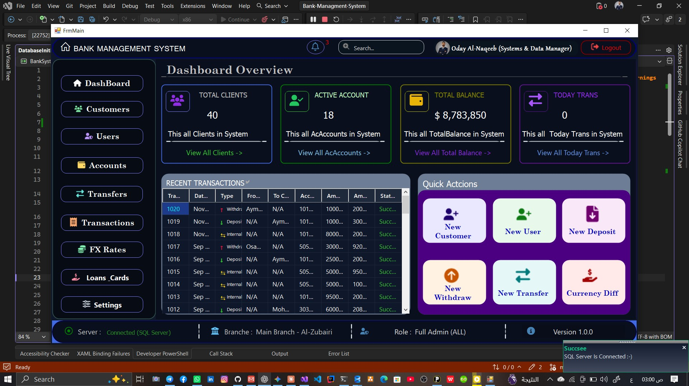
</p>

### Main Management Modules

| Customers Management | Accounts Management |
|:---:|:---:|
| 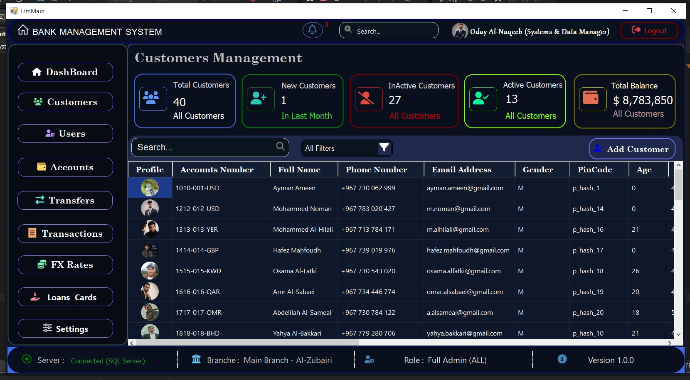 | 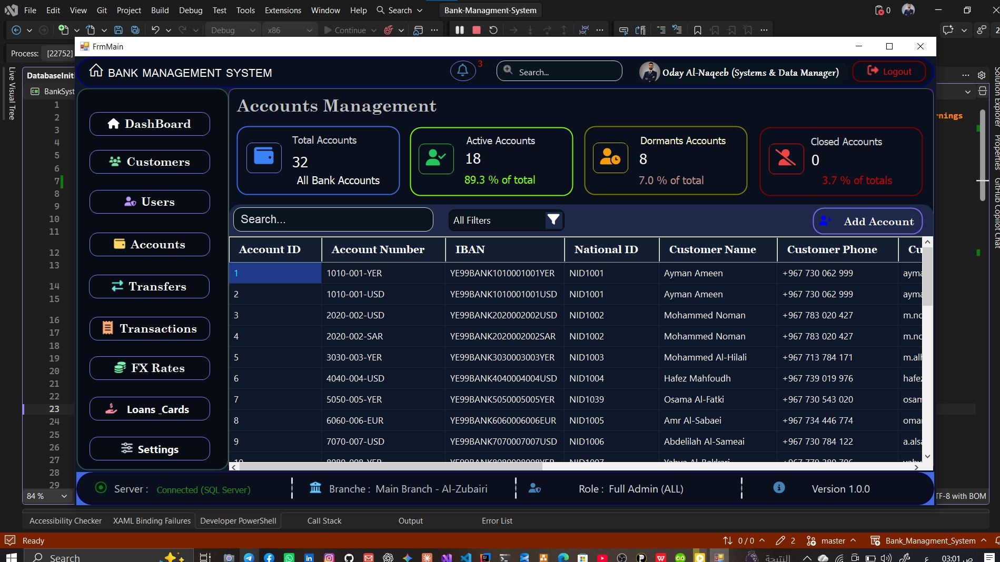 |

### Transactions

<p align="center">
  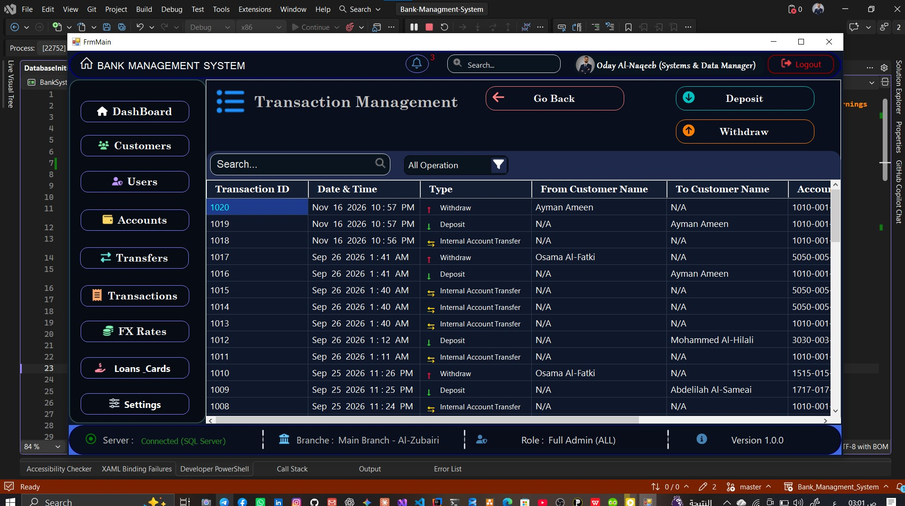
</p>

<details>
<summary><strong>🔍 View More Screenshots</strong></summary>

### Users Management

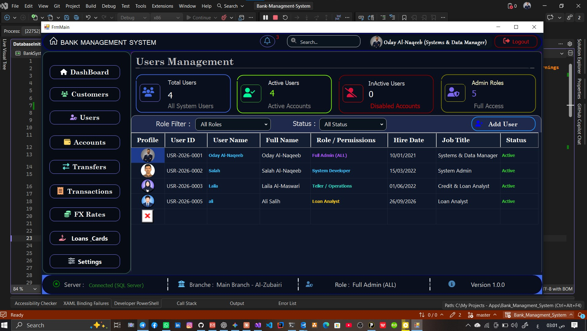

### Transfers

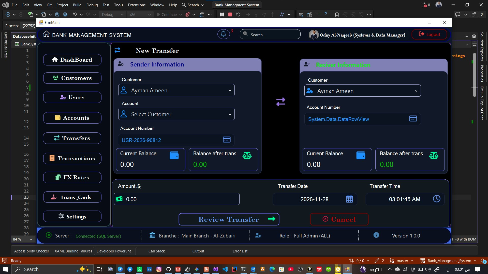

### Deposit

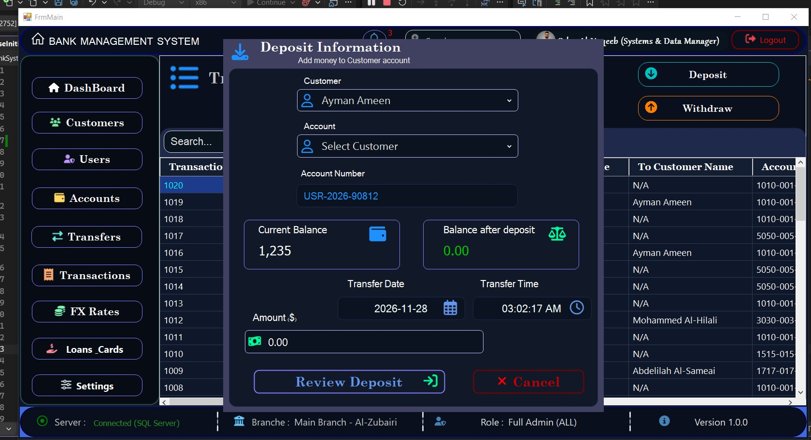

### Withdraw

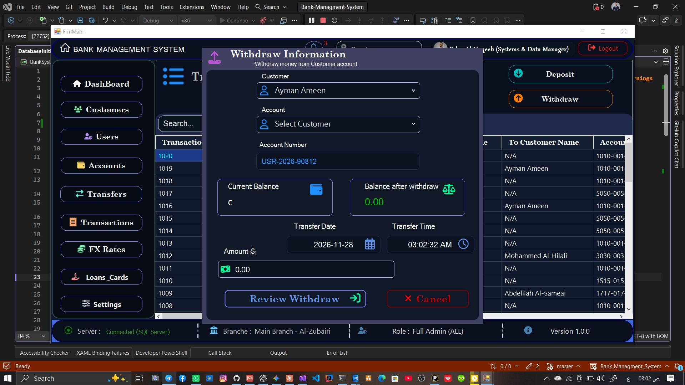

### Exchange Rates

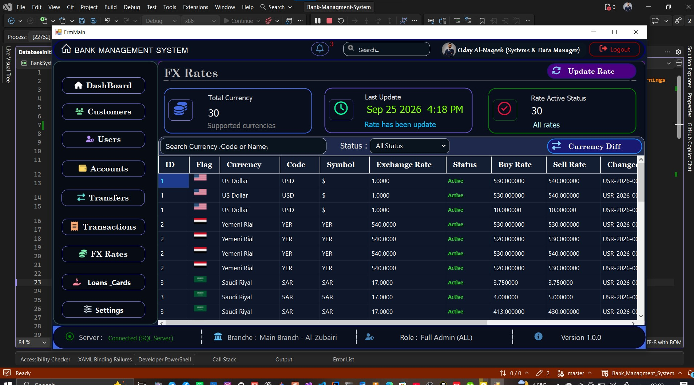

### Exchange Rate Difference

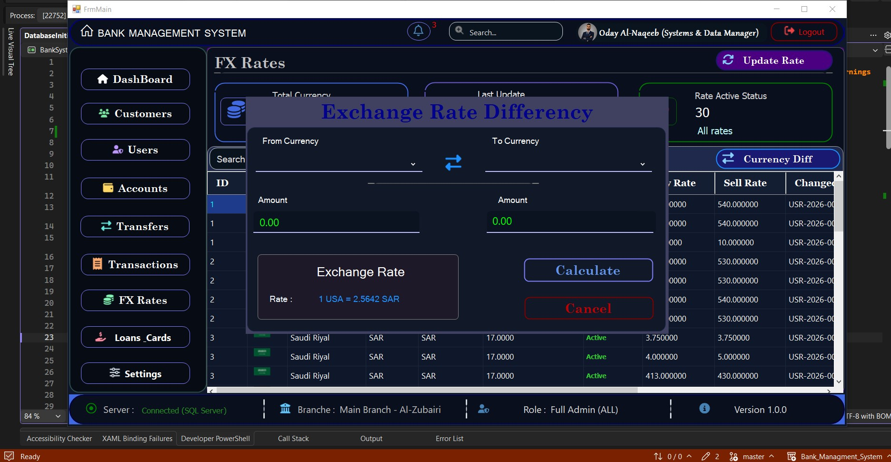

### Update Exchange Rate

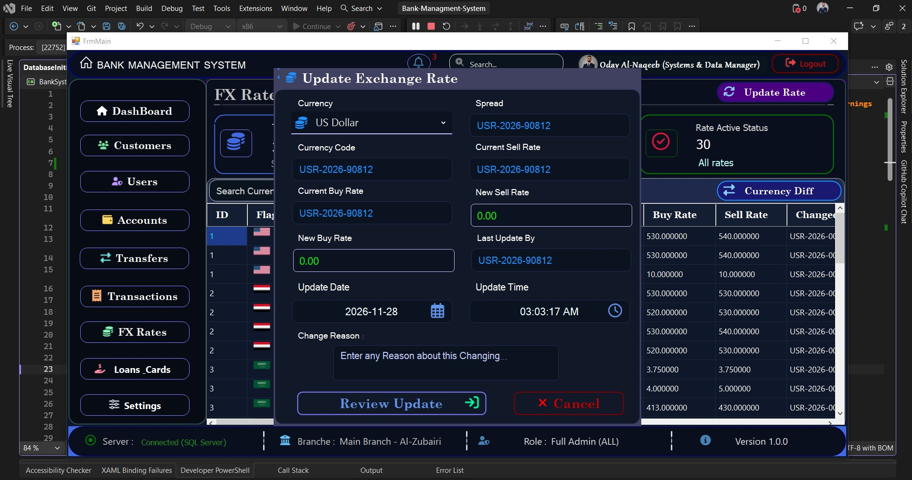

</details>

---

## 🏗️ System Architecture

The project follows the **Three-Tier Architecture** pattern.

This architectural approach separates the application into three independent layers, each responsible for a specific part of the system.

```text
                  ┌──────────────────────────┐
                  │    Presentation Layer    │
                  │                          │
                  │       Windows Forms      │
                  │       User Interface     │
                  └────────────┬─────────────┘
                               │
                               ▼
                  ┌──────────────────────────┐
                  │      Business Layer      │
                  │                          │
                  │    Business Logic        │
                  │    Validation            │
                  │    Application Rules     │
                  └────────────┬─────────────┘
                               │
                               ▼
                  ┌──────────────────────────┐
                  │    Data Access Layer     │
                  │                          │
                  │    SQL Operations        │
                  │    Database Connectivity │
                  │    Data Retrieval        │
                  └────────────┬─────────────┘
                               │
                               ▼
                  ┌──────────────────────────┐
                  │      SQL Server          │
                  │                          │
                  │      BankSystemDB        │
                  └──────────────────────────┘
```

### 1. Presentation Layer

Responsible for:
- Windows Forms interfaces.
- User interaction.
- Displaying application data.
- Communicating with the Business Layer.

**Project:** `WindowsFormsApp2`

### 2. Business Logic Layer

Responsible for:
- Implementing business rules.
- Processing application operations.
- Validating business-related data.
- Coordinating between the UI and Data Access Layer.

**Project:** `BankSystemBuisniseLayer`

### 3. Data Access Layer

Responsible for:
- Database connectivity.
- Executing SQL queries.
- Inserting, updating, and deleting records.
- Retrieving data from SQL Server.

**Project:** `BankSystemDataAccess`

---

## 🛠️ Technologies & Tools

| Technology | Purpose |
|---|---|
| C# | Main Programming Language |
| .NET Framework 4.7.2 | Application Framework |
| Windows Forms | Desktop User Interface |
| Microsoft SQL Server | Relational Database Management System |
| ADO.NET | Database Connectivity and Data Access |
| T-SQL | Database Queries and Scripts |
| Visual Studio | Development Environment |
| Git | Version Control |
| GitHub | Source Code Hosting |

---

## 🗄️ Database Design

The application uses **Microsoft SQL Server** as its relational database management system.

The database is named:

`BankSystemDB`

The database schema contains multiple interconnected tables covering different banking domains, including:

- Users and Persons.
- Branches and Departments.
- Roles and Permissions.
- Accounts and Account Types.
- Cards.
- Transactions and Transaction Types.
- Clients.
- Countries and Cities.
- Currencies and Exchange Rate History.
- Loans and Loan Installments.
- Loan Guarantors.
- Notifications.
- Daily Branch Summaries.

The database also includes views to simplify access to related data and support application operations.

---

## 🏗️ System Architecture

The following diagram illustrates the overall architecture of the Bank Management System, including its application workflow, architectural layers, and interactions between the main components.

<p align="center">
  <a href="https://gitdiagram.com/oday-alnaqep-cs/bank-management-system">
    
  </a>
</p>

<p align="center">
  <a href="https://gitdiagram.com/oday-alnaqep-cs/bank-management-system">
    <strong>🔍 Explore Interactive Architecture Diagram ↗</strong>
  </a>
</p>

---

### 🖼️ Database ERD Preview

<details>
  <summary><strong>🔍 Click to View ERD Preview</strong></summary>

  <br/>

  <p align="center">
    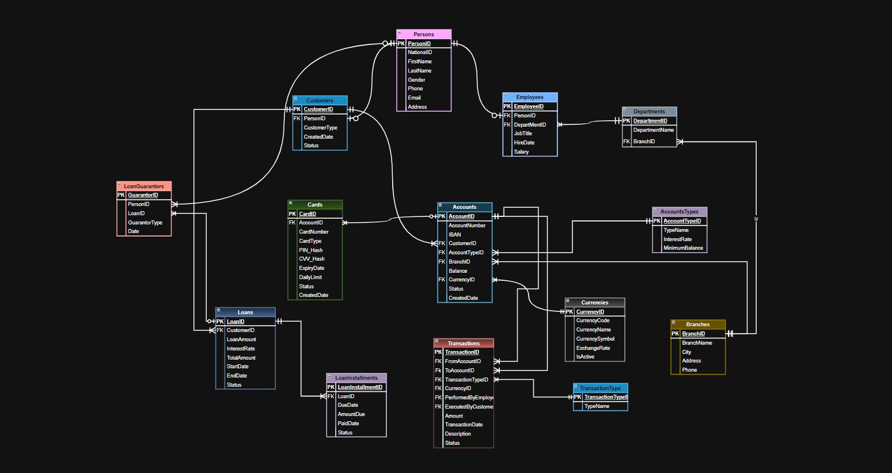
  </p>

  <p align="center">
    <sub>Entity Relationship Diagram — Visual Preview</sub>
  </p>

</details>

<p align="center">
  <a href="WindowsFormsApp2/ERD_Bank_System.pdf">
    <strong>📄 View Full Database ERD (PDF) ↗</strong>
  </a>
</p>

---

### 📄 Full Database ERD

<p align="center">
  <a href="WindowsFormsApp2/ERD_Bank_System.pdf">
    <strong>📥 View Full Entity Relationship Diagram (PDF) ↗</strong>
  </a>
</p>

<p align="center">
  <sub>Open the complete database diagram in PDF format.</sub>
</p>
---

## 📂 Project Structure

The solution is organized into three main projects:

```text
Bank-Management-System/
│
├── WindowsFormsApp2/
│   │
│   ├── Account/
│   ├── Balance/
│   ├── Currency/
│   ├── Customer/
│   ├── Dash Board/
│   ├── DataBaseSql/
│   │   └── BankSystemDB.sql
│   │
│   ├── Screenshots/
│   │   ├── Dashboard.png
│   │   ├── Customers.png
│   │   ├── Users.png
│   │   ├── Accounts.png
│   │   ├── Transactions.png
│   │   ├── Transfers.png
│   │   ├── Deposit.png
│   │   ├── Withdraw.png
│   │   ├── Rates.png
│   │   ├── ExchangeRateDiff.png
│   │   └── UpdateEchangeRate.png
│   │
│   ├── ERD_Bank_System.pdf
│   ├── App.config
│   └── Program.cs
│
├── BankSystemBuisniseLayer/
│   └── Business Logic Classes
│
├── BankSystemDataAccess/
│   ├── DatabaseInitializer.cs
│   ├── ClsDataAccessSettings.cs
│   └── Data Access Classes
│
└── README.md
```

---

## 🚀 Getting Started

Follow these steps to run the project locally.

### Prerequisites

Make sure you have the following installed:

- Visual Studio.
- .NET Framework 4.7.2 Developer Pack.
- Microsoft SQL Server 2016 or later.
- SQL Server Management Studio (SSMS).

### 1. Clone the Repository

```bash
git clone https://github.com/Oday-Alnaqep-CS/Bank-Management-System.git
```

### 2. Open the Solution

Open the solution file using Visual Studio.

### 3. Configure the Database Connection

Open the database configuration files and configure the SQL Server connection string according to your local environment.

**Important:** Do not commit database usernames, passwords, or other sensitive credentials to the repository.

### 4. Configure the Database Script

Make sure the database initialization script is available at the path expected by the application at runtime.

The SQL script is located in:

```text
WindowsFormsApp2/DataBaseSql/BankSystemDB.sql
```

If the initializer reads the script from the application's output directory, configure the SQL file to be copied to the appropriate output location.

### 5. Build the Solution

Build the solution in Visual Studio to restore references and compile the projects.

### 6. Run the Application

Set `WindowsFormsApp2` as the startup project and run the application.

---

## ⚙️ Database Initialization

The application includes a database initialization mechanism.

During application startup, the initialization process is invoked before opening the login form.

The startup sequence is:

```text
Application Startup
       │
       ▼
InitializeDatabase()
       │
       ▼
Check Database Existence
       │
       ├── Database Exists
       │       │
       │       ▼
       │   Continue Startup
       │
       └── Database Does Not Exist
               │
               ▼
         Create Database
               │
               ▼
         Execute SQL Script
               │
               ▼
         Continue Startup
               │
               ▼
           Login Form
```

The initialization process checks whether the database exists before attempting to create it.

---

## 🧠 Software Engineering Concepts

Throughout the development of this project, several software engineering concepts and practices are applied:

- Object-Oriented Programming (OOP).
- Three-Tier Architecture.
- Separation of Concerns.
- Data Access Abstraction.
- Business Logic Encapsulation.
- Database Relationships.
- SQL Server Database Design.
- ADO.NET.
- Code Reusability.
- Maintainable Code Organization.

---

## 🛣️ Future Improvements

Potential areas for future development include:

- Strengthening authentication and authorization.
- Improving exception handling and logging.
- Adding automated unit and integration tests.
- Enhancing application security.
- Improving reporting and analytics.
- Optimizing database performance.
- Refining the user interface and user experience.

---

## 👨‍💻 Author

<p align="center">
  <strong>ENG. ODAY AL-NAQEEB</strong>
  <br/>
  Computer Science Student | Software Developer
  <br/>
  Taiz University
</p>

<p align="center">
  <a href="https://github.com/Oday-Alnaqep-CS">
    
  </a>
</p>

---

<p align="center">
  <strong>Built with dedication, continuous learning, and a passion for software development.</strong>
</p>

<p align="center">
  ⭐ If you find this project interesting, consider giving it a star!
</p>
